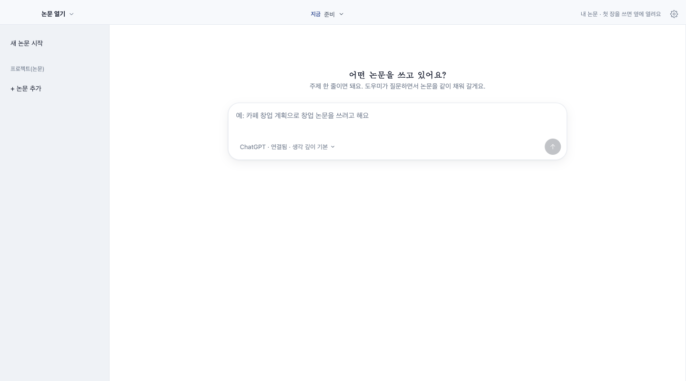
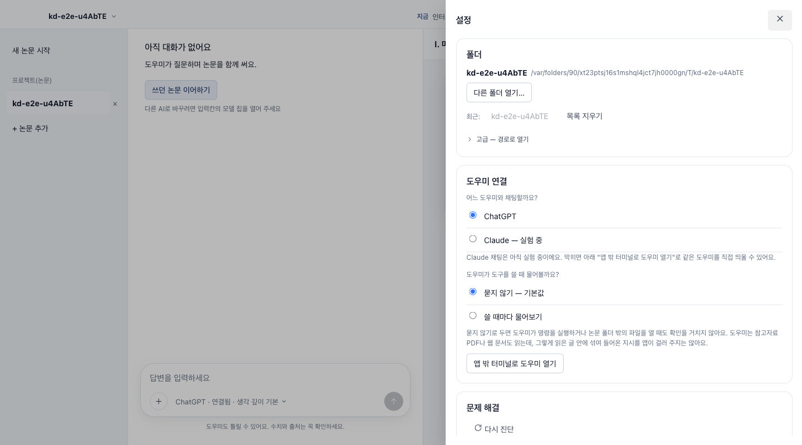
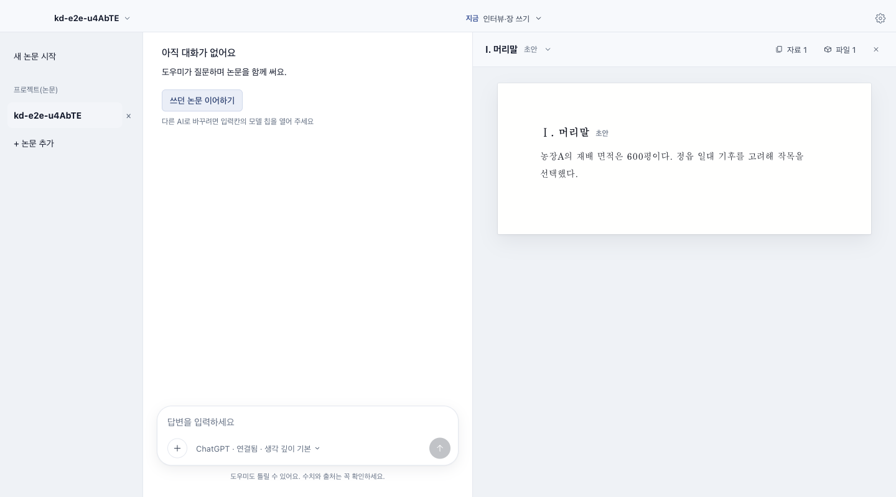
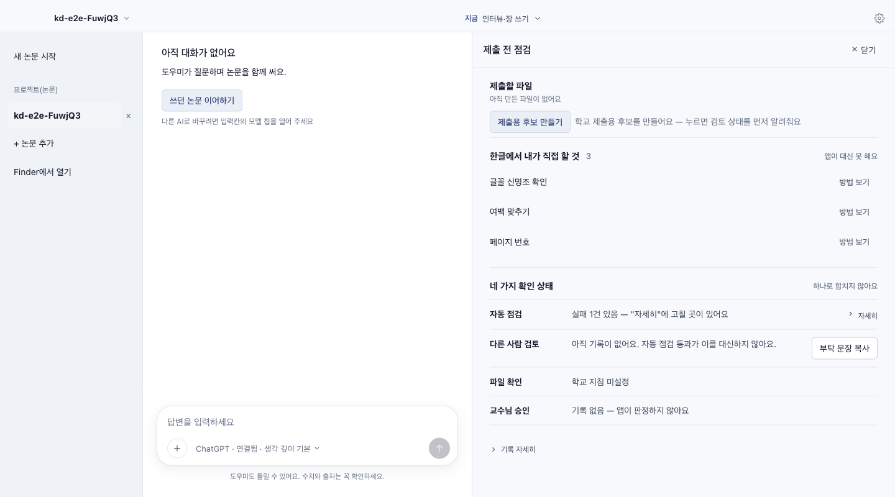
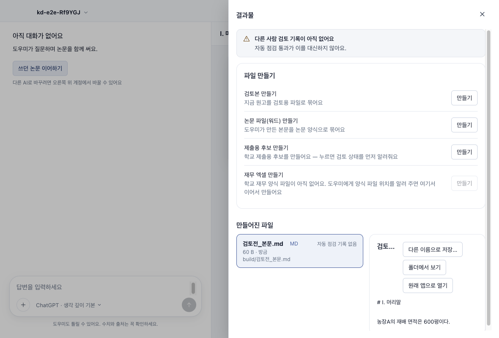
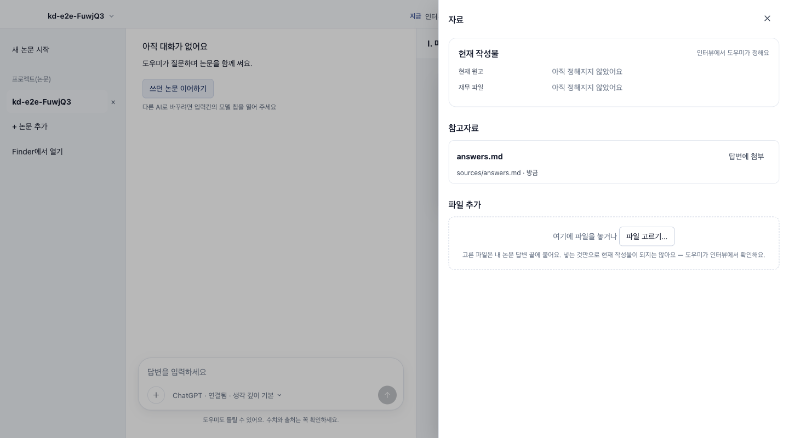
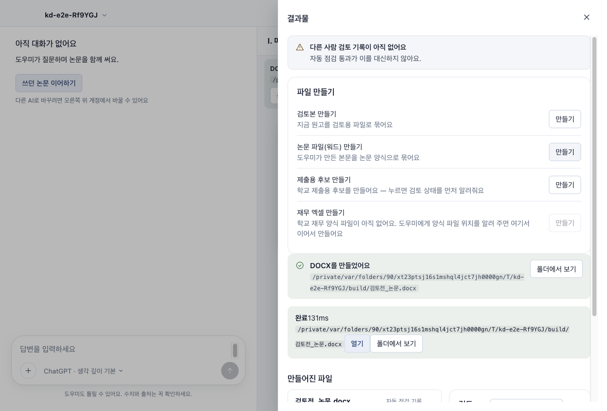

# KNUAF-Dev · 창업논문 작성 도우미 사용 안내 (학생용)

논문은 AI 도우미가 채팅으로 인터뷰하며 써요. 이 앱은 그 옆에서 저장 상태와 점검 결과를 보여 주고, 버튼으로 결과물을 만들어요.

## 1. 이 툴은 무엇인가요

먼저 이것만은 꼭 알아 두세요.

- **논문을 쓰는 건 AI 도우미(Codex 또는 Claude Code)예요.** 도우미가 채팅으로 질문하고, 답을 들으며 논문을 써요. 인터뷰 답변도 채팅에서 해요.
- **이 앱은 논문을 쓰지 않아요.** 도우미가 저장한 내용을 읽어서 저장 상태, 점검 결과, 만들어진 파일을 보여 줘요. 자동 점검과 파일 만들기, 복구는 버튼으로 실행해요.
- **AI 도우미는 이 앱 안에서 열어요.** "내 논문" 화면에서 ChatGPT 또는 Claude와 채팅해요.
- 명령어나 JSON은 몰라도 돼요.

<svg xmlns="http://www.w3.org/2000/svg" width="720" height="250" viewBox="0 0 720 250" font-family="-apple-system, 'Apple SD Gothic Neo', Pretendard, sans-serif" font-size="13" role="img" aria-label="학생, AI 도우미, 논문 폴더, 이 앱의 관계">
  <defs>
    <marker id="arr" viewBox="0 0 10 10" refX="9" refY="5" markerWidth="8" markerHeight="8" orient="auto-start-reverse">
      <path d="M0,0 L10,5 L0,10 z" fill="#444" />
    </marker>
    <marker id="arrg" viewBox="0 0 10 10" refX="9" refY="5" markerWidth="8" markerHeight="8" orient="auto-start-reverse">
      <path d="M0,0 L10,5 L0,10 z" fill="#2f6b3a" />
    </marker>
  </defs>
  <!-- 학생 -->
  <rect x="20" y="70" width="110" height="70" rx="8" fill="#fff" stroke="#444" stroke-width="1.5" />
  <text x="75" y="110" text-anchor="middle" font-size="15" font-weight="600" fill="#222">학생</text>
  <!-- AI 도우미 -->
  <rect x="200" y="50" width="220" height="110" rx="8" fill="#fff" stroke="#444" stroke-width="1.5" />
  <text x="310" y="80" text-anchor="middle" font-size="15" font-weight="600" fill="#222">AI 도우미 (Codex · Claude)</text>
  <text x="310" y="104" text-anchor="middle" fill="#444">채팅으로 인터뷰</text>
  <text x="310" y="124" text-anchor="middle" fill="#444">논문 작문 · 저장 요청</text>
  <text x="310" y="146" text-anchor="middle" font-size="11" fill="#777">앱 안 채팅</text>
  <!-- 학생 <-> 도우미 -->
  <line x1="134" y1="105" x2="196" y2="105" stroke="#444" stroke-width="1.5" marker-start="url(#arr)" marker-end="url(#arr)" />
  <text x="165" y="94" text-anchor="middle" font-size="11" fill="#666">질문 · 답변</text>
  <!-- 논문 폴더 -->
  <rect x="490" y="50" width="210" height="110" rx="8" fill="#f4f8f5" stroke="#2f6b3a" stroke-width="1.5" />
  <text x="595" y="80" text-anchor="middle" font-size="15" font-weight="600" fill="#2f6b3a">논문 폴더</text>
  <text x="595" y="104" text-anchor="middle" fill="#444">논문 데이터 · 장 파일</text>
  <text x="595" y="124" text-anchor="middle" fill="#444">결과물(DOCX · 엑셀)</text>
  <text x="595" y="146" text-anchor="middle" font-size="11" fill="#777">내 컴퓨터 안</text>
  <!-- 도우미 -> 폴더 -->
  <line x1="424" y1="105" x2="486" y2="105" stroke="#2f6b3a" stroke-width="1.5" marker-end="url(#arrg)" />
  <text x="455" y="94" text-anchor="middle" font-size="11" fill="#2f6b3a">저장</text>
  <!-- 이 앱 -->
  <rect x="490" y="185" width="210" height="52" rx="8" fill="#fff" stroke="#444" stroke-width="1.5" />
  <text x="595" y="207" text-anchor="middle" font-size="15" font-weight="600" fill="#222">이 앱</text>
  <text x="595" y="226" text-anchor="middle" font-size="12" fill="#444">상태 · 점검 · 만들기 · 복구</text>
  <!-- 앱 -> 폴더 -->
  <line x1="595" y1="181" x2="595" y2="164" stroke="#2f6b3a" stroke-width="1.5" marker-end="url(#arrg)" />
  <text x="608" y="177" font-size="11" fill="#2f6b3a">읽기 · 점검</text>
  <!-- 학생 -> 앱 -->
  <path d="M75,144 L75,211 L486,211" fill="none" stroke="#444" stroke-width="1.5" marker-end="url(#arr)" />
  <text x="280" y="203" text-anchor="middle" font-size="11" fill="#666">버튼으로 실행 · 결과 확인</text>
</svg>

## 2. 준비물

- **Mac 또는 Windows PC** — macOS 14 이상, 또는 Windows 10/11 64비트예요.
- **Microsoft Word, Excel** (선택) — 최종 문서를 실제로 열어 보고 렌더할 때 써요. 없어도 논문 쓰기는 돼요.
- **ChatGPT 계정 또는 Claude 계정** — ChatGPT 채팅은 ChatGPT 로그인으로 써요. Claude에는 Pro, Max 같은 **유료 요금제** 계정이 필요해요. 둘 중 하나만 있어도 시작할 수 있어요.
- **Codex 또는 Claude Code** — **Windows 설치본에는 Codex 가 함께 들어 있어 따로 설치하지 않아요**(처음 한 번 ChatGPT 로그인만). 맥은 터미널에서 `npm i -g @openai/codex` 로 직접 설치해요. Claude Code 는 어느 쪽이든 직접 설치해요 — `curl -fsSL https://claude.ai/install.sh | bash`.

## 3. 설치

**macOS**

1. `KNUAF Thesis Helper-….dmg`를 열어요.
2. 앱을 **응용 프로그램** 폴더로 끌어다 놓아요.

**Windows**

1. 릴리스에서 `knuaf-dev-….exe`를 내려받아 두 번 눌러요. **Chrome으로 받기를 권해요.** Edge에서 "일반적으로 다운로드되지 않습니다"로 막히면 항목 옆 **… → 유지**를 누르거나 Chrome으로 받아 봐요.
2. **"Windows의 PC 보호"** 창이 뜨면 **추가 정보 → 실행**을 눌러요. "추가 정보"가 안 보이면 파일을 오른쪽 클릭 → **속성** → **차단 해제** → **확인** 뒤 다시 실행해요.
3. 설치 창에서 **설치**를 눌러요.

사진과 함께 보려면 [설치 안내 (Windows)](https://github.com/knuaf-devcat/knuaf-dev/blob/main/docs/%EC%84%A4%EC%B9%98-%EC%95%88%EB%82%B4-Windows.md)를 봐요.

## 4. 처음 실행

앱은 아직 서명이 없어서 처음에는 경고가 나올 수 있어요.

- **macOS 14 이하**: 응용 프로그램에서 앱을 **오른쪽 클릭 → 열기 → 열기**.
- **macOS 15 이상**: 한 번 실행을 시도한 뒤 **시스템 설정 → 개인정보 보호 및 보안** 맨 아래에서 **그래도 열기**.
- **Windows**: **"Windows의 PC 보호"** 창이 뜨면 **추가 정보 → 실행**을 눌러요. 설치할 때와 같은 창이에요. 자세한 순서는 [설치 안내 (Windows)](https://github.com/knuaf-devcat/knuaf-dev/blob/main/docs/%EC%84%A4%EC%B9%98-%EC%95%88%EB%82%B4-Windows.md)에 있어요.

두 번째부터는 그냥 실행하면 돼요.

## 5. 폴더 열기

앱을 열면 바로 대화창이 보여요. 첫 메시지를 보내면 논문 파일을 둘 곳을 한 번 물어요.
무엇을 쓸지 막막하면 입력칸 아래 제안 단추를 눌러 첫 문장을 채우고, 주제나 상황을 덧붙여 보낼 수 있어요. 이미 적은 글은 지우지 않고 제안 문장을 덧붙여요.
**쓰던 원고(docx) 이어 쓰기**는 기존 대화를 여는 단추가 아니라 원고에 관한 새 요청이에요. 원고가 있는 폴더는 메시지를 보낸 뒤 **내 폴더 고르기**로 선택하세요.
**제출 전 점검만**도 점검 요청 문장을 채우는 단추예요. 자동 점검 결과는 논문을 연 뒤 **점검**에서 확인할 수 있어요.
**앱이 만들어 둘게요**를 고르면 `문서/knuaf-dev/논문 이름`에 새 폴더를 만들어요. 이름은 고치거나 그대로 쓸 수 있어요.
이미 쓰던 폴더가 있으면 **내 폴더 고르기**를 눌러요. 최근 논문은 왼쪽 **프로젝트(논문)**에서 다시 열 수 있어요.
폴더 위치는 목록의 **Finder에서 열기**(Windows에서는 **파일 탐색기에서 열기**)로 확인해요. 좁은 창에서는 왼쪽 위 **프로젝트 목록** 단추로 목록을 열고, 목록 바깥을 눌러 닫아요.

## 6. 작업 준비 (자동)

폴더를 열면 점검과 파일 만들기에 필요한 도구를 논문 폴더 안 `.venv`에 자동으로 준비해요.
준비가 안 되면 화면에 알림이 뜨고, **설정 → 문제 해결 → 준비 상태 → 패키지 준비**에서 다시 시도할 수 있어요.
컴퓨터의 다른 Python은 건드리지 않아요. 인터넷이 없어도 앱 안에 들어 있는 파일로 설치돼요.

## 7. 내 논문 화면에서 인터뷰하기

**내 논문** 화면이 인터뷰와 작문이 일어나는 곳이에요. 앱이 규칙집을 논문 폴더 안의 도우미 설정 폴더에 자동으로 넣어 둬요. 도우미가 논문을 어떤 순서와 형식으로 쓸지 적힌 파일이에요. 내 자료는 옮기지 않아요.

입력칸의 모델 칩에서 ChatGPT 또는 Claude를 연결하고 바꿀 수 있어요. 처음 연결할 때는 모델 칩 안의 로그인 단추를 눌러 브라우저에서 로그인해요.
Enter는 전송, Shift+Enter는 줄바꿈이에요. AI 회사를 바꾸면 다른 회사와 나눈 대화는 이어서 볼 수 없지만 논문 파일과 진행 상황은 그대로예요.

고른 AI는 기억해요. 바꾸려면 입력칸의 모델 칩을 열어요.
모델 칩의 추천은 계정에서 고를 수 있는 모델을 기준으로 표시해요. 같은 이름의 모델이 여러 세대이고 세대를 읽을 수 있으면 최신 세대에 추천을 붙여요.

모델 칩에 **모델 다시 선택 필요**가 뜨면 저장된 모델이 다른 AI 회사로 연결되는 모델이에요. 앱이 임의로 계정 기본값으로 바꿔 보내지 않아요. 칩을 열어 ChatGPT 모델이나 **안 고름(계정 기본)**을 직접 고른 뒤 다시 보내 주세요. 목록을 불러오지 못해도 이 안내와 기존 설정은 유지돼요. 계정 기본 모델 자체가 다른 AI 회사로 연결되면 전송을 막으니, 목록에서 ChatGPT 모델을 직접 골라 주세요.

알아 두면 좋은 것:

- 답변이 **전송 여부 불확실**로 표시되면 내용을 확인한 뒤 **다시 보내기**를 눌러요. 앱은 답변이 도우미에게 닿았는지 스스로 판단하지 않아요.
- 도우미가 답변을 만들거나 터미널이 막 출력을 낸 동안에는 저장·점검 버튼이 잠시 막혀요("AI 도우미가 작업 중이에요"). 답변이 끝나거나 터미널 출력이 멈춘 뒤 다시 누르면 돼요.
- 반대로 앱이 저장·점검을 하는 동안에는 채팅 전송이 잠시 막혀요. 끝난 뒤 보내면 돼요.
- 도우미가 저장할 때마다 **점검** 화면이 새로 바뀌어요.

예전 방식으로 macOS 터미널 창을 따로 열고 싶으면 **설정 → 도우미 연결 → 앱 밖 터미널로 도우미 열기**를 써요. 그 경우 인터뷰 답변은 따로 열린 터미널 창에서 해요.

## 8. 화면 안내

왼쪽에는 최근 프로젝트가 보여요. 대화 옆의 **내 논문**에서 본문을 읽고, 자료·결과물·점검·설정은 작업 공간 위에 열어요.

| 화면 | 보여 주는 것 |
|---|---|
| 내 논문 | AI 도우미와의 인터뷰·작문, 저장된 논문 본문 |
| 자료 | 인터뷰에서 정해진 현재 작성물·재무 파일과 sources 폴더의 파일(현재 작성물·참고자료 구분), 파일 첨부 |
| 결과물 | build 폴더에 만들어진 DOCX·엑셀·PDF·메모의 목록과 미리보기, 다른 이름으로 저장 |
| 점검 | 내가 해야 할 일 · 고칠 곳 · 아직 확인 못 한 것, 그리고 자동 점검·다른 사람 검토·파일 확인·교수님 승인 네 가지를 따로 |
| 설정 | 폴더, 도우미 연결, 문제 해결, 고급 도구, Python 실행기와 앱 정보 |

**독립검토 미실행** 알림은 점검 화면의 "다른 사람 검토" 줄과, 제출용 파일을 만들거나 결과물을 저장하려는 지점에 떠요. 아직 작성자와 다른 사람이 내용을 검토한 기록이 없다는 뜻이에요. 자동 점검 통과와는 별개예요.

## 9. 자료 넣기

**자료** 화면은 인터뷰에서 정해진 현재 작성물과 참고자료를 구분해 보여 줘요.

- **현재 작성물** — 인터뷰에서 도우미가 확인한 현재 원고와 재무 파일이에요. 아직 안 정해졌으면 "아직 정해지지 않았어요"로 보여요. 어떤 파일이 현재 작성물인지는 인터뷰에서만 정해져요.
- **참고자료** — 논문 폴더 안 `sources` 폴더의 파일이에요. 현재 작성물로 정해진 파일에는 따로 표시가 붙어요.
- **파일 추가** — **파일 고르기…** 버튼이나 화면에 끌어다 놓기로 파일을 골라요. 고른 파일의 경로가 "내 논문" 답변 끝에 붙고 내 논문 화면으로 가요. **파일을 넣는 것만으로 현재 작성물이 정해지지 않아요.** 도우미가 인터뷰에서 확인해요. 파일 목록의 **답변에 첨부**로 이미 있는 파일을 보낼 수도 있어요.

## 10. 결과물 보기·저장

**결과물** 화면 맨 위의 **파일 만들기**에서 검토본·논문 DOCX·제출용 후보를 만들어요. 재무 엑셀은 학교 재무 양식 파일이 필요하며, 아직 정해지지 않았다면 도우미에게 양식 파일 위치를 알려 주세요. 아래 목록은 도우미가 `build` 폴더에 만든 파일을 보여 줘요. 왼쪽 목록에서 고르면 오른쪽에 미리보기가 떠요.

- **PDF** — 바로 페이지를 넘겨 볼 수 있어요.
- **DOCX** — 같은 이름의 PDF가 있으면 그 PDF를 보여 줘요. 없으면 **Word로 PDF 만들기**로 만들거나 **원래 앱으로 열기**로 Word에서 열어요.
- **엑셀(XLSX)** — 시트를 골라 표로 읽어요(읽기 전용). 수식이 실제 Excel 재산을 거치지 않았으면 경고가 붙어요.
- **메모(Markdown)** — 내용을 그대로 읽어요.

각 파일에는 **다른 이름으로 저장…**(원하는 곳에 복사), **폴더에서 보기**, **원래 앱으로 열기** 버튼이 있어요. 자동 점검 기록이 있는 파일은 통과/실패 표시도 붙어요.

## 11. 막혔을 때

- **"다른 작업이 이 폴더를 잠그고 있어요"** — 도우미가 저장 중이면 잠깐 기다려요. 아무것도 안 돌고 있는데 계속 그러면 **설정 → 문제 해결 → 쓰기 잠금**에서 상태를 보고, "남은 잠금"이면 **잠금 해제**를 눌러요. 다른 컴퓨터의 잠금이거나 아직 살아 있는 작업의 잠금은 앱이 풀지 않아요.
- **이전 상태로 되돌리고 싶을 때** — **설정 → 문제 해결 → 이전 원고 스냅샷**에서 이전 기록으로 복원할 수 있어요. 복원 전에 지금 상태를 먼저 저장해 두니 되돌릴 수 있어요. 장 파일과 만들어진 문서는 그대로예요.
- **"작업 준비가 아직 끝나지 않았어요" 또는 "준비 중 문제가 생겼어요"** — **설정 → 문제 해결 → 준비 상태 → 패키지 준비**를 눌러요.
- **"AI 도우미가 작업 중이에요"라고 나올 때** — 도우미가 답변을 만들거나 터미널이 방금 출력을 낸 상태예요. 잠시 기다렸다가 다시 눌러요.
- **답변이 "전송 여부 불확실"로 표시될 때** — 답변이 도우미에게 닿았는지 앱이 알 수 없는 상태예요. 내용을 확인하고 메시지 옆의 **다시 보내기**를 눌러요.
- **앱이 작업 도중 종료됐다고 나올 때** — 내 논문 화면에 대화가 그대로 남아 있어요. 마지막 답변은 자동으로 다시 보내지 않으니, 필요하면 **다시 보내기**를 눌러요.
- **터미널의 도우미가 꺼졌을 때** — 내 논문 화면에서 **다시 시작** 또는 **이어서 하기**를 눌러요. 이전 대화를 이어갈 수 있어요.
- **Windows에서 설치 파일을 내려받을 때 Edge가 막을 때** — "일반적으로 다운로드되지 않습니다"가 뜨면 항목 옆 **… → 유지**를 눌러요. 그래도 안 되면 **Chrome 브라우저**로 내려받아요. PC 보호 기능이나 방화벽은 끄지 마세요.
- **Windows에서 처음 실행할 때 "Windows의 PC 보호"가 뜰 때** — **추가 정보 → 실행**을 눌러요. 창이 안 보이면 내려받은 파일을 오른쪽 클릭 → **속성** → **차단 해제** → **확인** 뒤 다시 실행해요. 사진과 함께 보려면 [설치 안내 (Windows)](https://github.com/knuaf-devcat/knuaf-dev/blob/main/docs/%EC%84%A4%EC%B9%98-%EC%95%88%EB%82%B4-Windows.md).
- 오류 메시지의 **자세히**를 열어 그 내용을 도우미에게 붙여 넣으면 대부분 해결돼요.

## 12. 이 앱이 절대 하지 않는 것

- 인터뷰 답변을 앱 데이터로 저장하지 않아요. 답변은 AI 도우미에게 전달되고, 논문 데이터에 반영하는 건 도우미예요.
- 논문 본문을 편집하지 않아요. (읽기 전용 미리보기만)
- 만든 파일을 덮어쓰지 않아요. 같은 이름이 있으면 새 이름을 제안해요.
- 다른 사람의 파일을 지우지 않아요.
- 교수 승인을 판정하지 않아요.
- 자료를 임의로 컴퓨터 밖으로 보내지 않아요. AI 도우미를 연결했을 때만 답변과 작업 폴더의 내용이 선택한 제공업체(OpenAI 또는 Anthropic)로 전송돼요.

## 13. 자주 묻는 질문

**앱만으로 논문이 되나요?**
이 앱 안에서 돼요. 논문은 AI 도우미가 채팅으로 인터뷰하며 쓰고, 도우미는 "내 논문" 화면에서 바로 쓸 수 있어요. 이 앱은 그 결과를 보여 주고 점검과 파일 만들기를 도와요.

**인터넷이 필요한가요?**
AI 도우미를 쓸 때는 필요해요. 앱 자체는 인터넷 없이도 돼요. 자동 점검, 결과물 만들기, 복구는 모두 내 Mac 안에서 돌아가요.

**내 자료가 어디로 가나요?**
앱 자체는 자료를 밖으로 보내지 않아요. AI 도우미를 연결하면 답변과 작업 폴더의 내용이 선택한 제공업체(OpenAI 또는 Anthropic)로 전송돼요. 인터뷰에서 말한 내용과 도우미가 읽은 파일이 여기에 들어가요.
